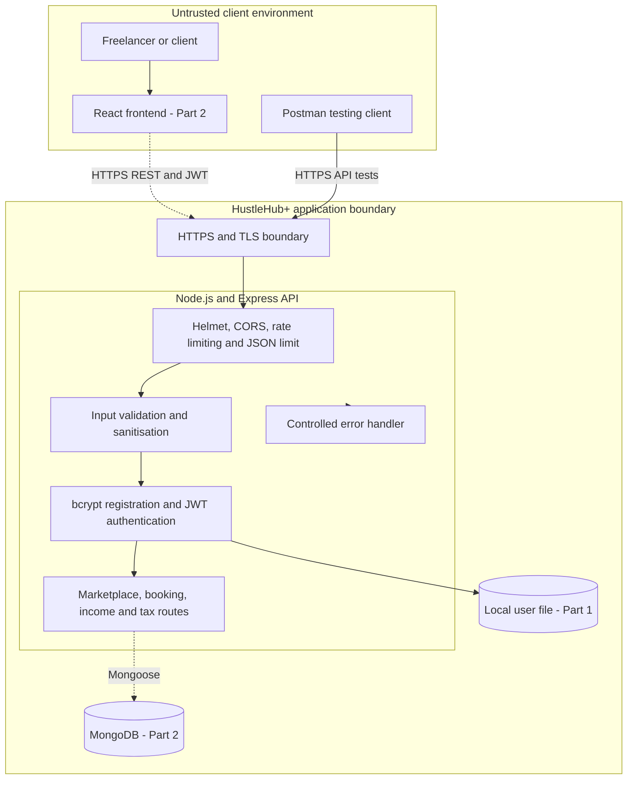

# HustleHub+ Secure Backend Foundations

HustleHub+ is a secure freelance marketplace being developed for the INSY7314 Portfolio of Evidence. It will allow freelancers to advertise services and clients to browse and book them. Later parts will record booking transactions, show freelancer income, and estimate tax obligations. Part 1 establishes the secure backend foundation: account registration, login, JWT authentication, input validation, HTTPS, and controlled error handling.

> **Assessment stage:** POE Part 1 — Secure Backend Foundations  
> **Student:** Antonio Bechev - ST10435330 
> **Repository:** https://github.com/EMGPSD/insy7314-g1-2026-poe-part-1-st10435330.git
> **Demonstration video:** https://youtu.be/SekUaTo0XDA

## Intended users

- **Freelancers** create accounts and will advertise services, receive bookings, and view income and estimated tax information.
- **Clients** create accounts and will browse services, make bookings, and view their booking history.
- **Platform administrators** are a planned future user group responsible for moderation, security monitoring, and marketplace support. Public registration cannot create an administrator account.

## MERN system architecture

The diagram represents the overall system planned across all three POE parts. Components with dashed outlines are planned for later parts. The Part 1 implementation is the Node.js and Express API, local file storage, and the security controls surrounding authentication.



### Architecture explanation

This design follows the MERN architecture:

1. **MongoDB** will provide persistent storage for users, services, bookings, transactions, and income records from Part 2. Part 1 deliberately uses a local JSON file because the brief permits local storage at this stage.
2. **Express** defines REST API routes and middleware for validation, authentication, security headers, rate limiting, and errors.
3. **React** will provide the browser interface in Part 2. It will make HTTPS requests and send the JWT in the `Authorization` header for protected operations.
4. **Node.js** runs the backend, HTTPS server, cryptographic libraries, and file-storage module.

The browser/Postman environment is outside the trusted system boundary. Requests cross an HTTPS boundary and pass through security middleware before reaching business logic. Only validated requests are processed. Passwords are hashed before storage. Protected routes verify the signature, algorithm, issuer, audience, and expiry of every JWT.

## Current backend structure

```text
hustlehub-plus/
├── certs/                    # Generated local certificate and private key
├── data/                     # Runtime user file (ignored by Git)
├── postman/                  # Importable assessment collection
├── screenshots/             # Screenshot checklist
├── scripts/
│   └── generate-cert.js      # Generates a local self-signed TLS certificate
├── src/
│   ├── middleware/           # JWT, validation, 404 and error middleware
│   ├── routes/               # Authentication and protected user routes
│   ├── storage/              # Local user repository
│   ├── app.js                # Express application and global middleware
│   ├── config.js             # Environment-based configuration
│   └── server.js             # HTTPS server entry point
├── test/                     # Automated API and security tests
├── .env.example              # Safe configuration template
└── package.json
```

The project separates server startup, routing, middleware, configuration, and storage. This makes it possible to replace the local store with MongoDB in Part 2 without rewriting authentication routes or security middleware.

## Security decisions

### Password hashing

Passwords are never written to storage or returned by the API in plain text. During registration, `bcryptjs` applies bcrypt with a cost factor of 12 and a unique salt. The resulting one-way hash is stored. During login, `bcrypt.compare()` checks the submitted password against that hash. Hashing limits the damage of a data leak because the original passwords are not directly recoverable. A deliberately slow password-hashing function also makes large-scale guessing more expensive.

### Token-based authentication

After successful login, the API signs a short-lived JWT using the configured secret and the HS256 algorithm. The token contains only the user's identifier (`sub`) and role, not a password or financial details. A client accesses protected endpoints by sending `Authorization: Bearer <token>`. Authentication middleware validates the token on every protected request, including its signature, permitted algorithm, expiry, issuer, and audience. Invalid, missing, altered, or expired tokens receive a controlled `401` response.

The JWT secret is loaded from `.env`, must be at least 32 characters, and is excluded from Git. In production, it should be supplied by a managed secrets service and rotated. JWTs should not be stored in insecure browser storage when the React frontend is added; a secure, HttpOnly cookie design should be evaluated in Part 2.

### Input validation

Every registration and login field is validated before business logic runs. Names are trimmed, length-limited, and restricted to sensible characters. Emails must be valid and are normalised. Public roles are allow-listed to `freelancer` or `client`. Passwords must contain 12–128 characters with upper-case, lower-case, numeric, and special characters. Request bodies are limited to 20 KB, helping reduce oversized-payload abuse. Invalid input receives `400 VALIDATION_ERROR` and is not stored.

Validation is important even with a future React interface because clients can bypass frontend validation and call the API directly. Server-side validation remains the authoritative security control.

### HTTPS

The Node server uses HTTPS and reads a locally generated TLS certificate and private key. HTTPS encrypts credentials and JWTs while they travel between the client and server, protecting them from passive network interception and modification. The included certificate is self-signed and intended only for local development. Production must use a certificate issued by a trusted certificate authority, redirect HTTP to HTTPS, and manage keys outside the repository.

### Additional protections

- **Helmet** supplies defensive HTTP headers.
- **CORS** permits only the configured frontend origin and required methods/headers.
- **Rate limiting** restricts repeated registration and login attempts.
- **Generic login errors** do not reveal whether an email address exists.
- **Controlled errors** provide stable codes and safe messages without stack traces, file paths, secrets, or configuration data.
- **Request IDs** make server-side troubleshooting possible without exposing internals.
- **Response minimisation** prevents password hashes from leaving the server.
- **Ignored runtime files** prevent `.env`, certificates, private keys, and stored user data from being committed accidentally.

This is an educational Part 1 implementation. File storage is not suitable for a horizontally scaled production system and will be replaced by MongoDB with schema controls and unique indexes in Part 2.

## API endpoints

| Method | Endpoint | Authentication | Purpose | Success |
| --- | --- | --- | --- | --- |
| `GET` | `/api/health` | No | Confirm API availability | `200` |
| `POST` | `/api/auth/register` | No | Register a freelancer or client | `201` |
| `POST` | `/api/auth/login` | No | Verify credentials and issue a JWT | `200` |
| `GET` | `/api/users/me` | Bearer JWT | Demonstrate a protected route | `200` |

### Registration body

```json
{
  "name": "Antonio Example",
  "email": "antonio@example.com",
  "password": "SecurePass123!",
  "role": "freelancer"
}
```

### Login body

```json
{
  "email": "antonio@example.com",
  "password": "SecurePass123!"
}
```

### Protected request

```http
GET /api/users/me HTTP/1.1
Host: localhost:3443
Authorization: Bearer <access-token>
```

### Controlled error format

```json
{
  "error": {
    "code": "INVALID_CREDENTIALS",
    "message": "Email or password is incorrect."
  }
}
```

## Installation and local HTTPS setup

### Prerequisites

- Node.js 20 or later
- npm
- Postman
- Git

### Steps

1. Clone the repository and enter its directory.
2. Install dependencies:

   ```bash
   npm install
   ```

3. Copy `.env.example` to `.env`.
4. Replace `JWT_SECRET` with a unique random value containing at least 32 characters. One option is:

   ```bash
   node -e "console.log(require('node:crypto').randomBytes(48).toString('hex'))"
   ```

5. Generate the local development certificate:

   ```bash
   npm run setup:cert
   ```

6. Start the API:

   ```bash
   npm start
   ```

7. Confirm that `https://localhost:3443/api/health` returns `{"status":"ok"}`. A self-signed certificate warning is expected locally.

Never commit `.env`, `certs/localhost.key`, `certs/localhost.crt`, or `data/users.json`. They are already included in `.gitignore`.

## Postman testing

Import [postman/HustleHub_Part1.postman_collection.json](postman/HustleHub_Part1.postman_collection.json). Because this project uses a self-signed local certificate, turn **Settings → General → SSL certificate verification** off for this local collection only. Do not disable certificate verification for production systems.

Run the collection in its numbered order. It automatically generates a unique demonstration email, stores the JWT returned by login, and supplies it to the protected request.

| # | Request | Expected result |
| --- | --- | --- |
| 1 | Health Check | `200`, API status is `ok` |
| 2 | Register - Success | `201`, safe user data returned |
| 3 | Register - Duplicate Email | `409 ACCOUNT_EXISTS` |
| 4 | Register - Invalid/Malicious Input | `400 VALIDATION_ERROR` |
| 5 | Login - Success | `200`, JWT generated and saved |
| 6 | Login - Wrong Password | `401 INVALID_CREDENTIALS` |
| 7 | Protected Profile - Success | `200`, authenticated user returned |
| 8 | Protected Profile - Missing Token | `401 AUTHENTICATION_REQUIRED` |
| 9 | Protected Profile - Invalid Token | `401 INVALID_TOKEN` |

The collection includes automated checks for response status, structure, token generation, and absence of passwords/hashes from successful registration responses.

## Automated tests

Run:

```bash
npm test
```

The test suite checks health status, valid registration, bcrypt storage, duplicate rejection, malicious/invalid input, login, generic credential failure, JWT route protection, successful token use, and safe malformed-JSON handling.

## Screenshots required for submission

After running the Postman collection, capture clear screenshots showing the request name, URL, request body or authorization tab where relevant, response status, and response JSON. The minimum recommended evidence is:

1. Successful registration (`201`)
2. Successful login and JWT generation (`200`)
3. Protected profile with Bearer token (`200`)
4. Invalid registration (`400`)
5. Incorrect login (`401`)
6. Missing or invalid token (`401`)

Save these in `screenshots/`. Do not expose your `.env` file or JWT secret in any screenshot.


## Known Part 1 limitations and future work

- Local JSON storage is suitable only for this assessment stage; MongoDB and Mongoose will be introduced in Part 2.
- Service listings, browsing, bookings, financial transactions, income totals, and tax estimates belong to later increments.
- The React client will be added in Part 2.
- Production deployment should use a trusted TLS certificate, managed secrets, security logging, monitoring, dependency scanning, and a tested token-revocation/refresh strategy.
