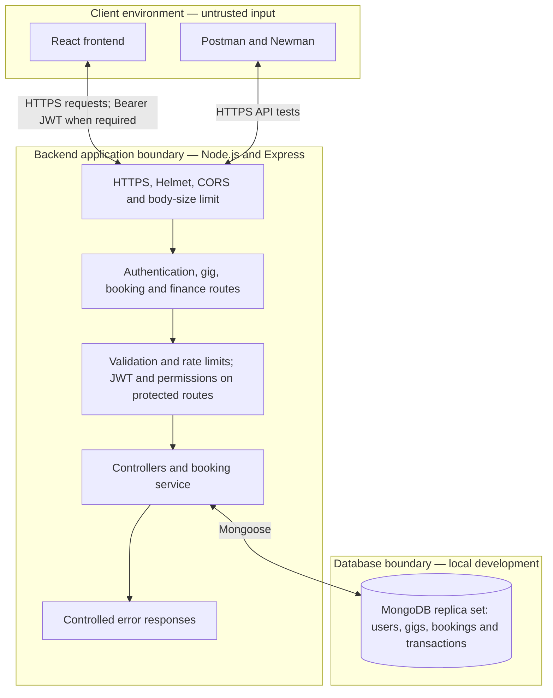

# HustleHub+ — INSY7314 POE Part 2

HustleHub+ is a freelance marketplace built with MongoDB, Express, React and
Node.js. Freelancers can advertise services, and clients can browse and book
them. Each confirmed booking creates a simulated transaction. Freelancers can
view their bookings and the income recorded from those transactions.

Part 2 extends the Part 1 authentication API with a database, a React interface,
marketplace features, role-based permissions and additional testing.

| Project information | Details |
| --- | --- |
| Student | Antonio Bechev — ST10435330 |
| Module | INSY7314 |
| Assessment | POE Part 2 — Secure Stack |
| Repository | [GitHub repository](https://github.com/EMGPSD/insy7314-g1-2026-poe-part-1-st10435330) |
| Part 1 demonstration | [Watch the Part 1 video](https://youtu.be/SekUaTo0XDA) |
| Part 2 demonstration | [Watch the Part 2 video](https://youtu.be/Ab1HLIkD1RM) | |

## Users and features

### Freelancers

- Register and log in with a freelancer account.
- Create, view, edit and remove their own gigs.
- View bookings made for their services.
- View their associated transactions and total simulated income.

### Clients

- Register and log in with a client account.
- Browse available gigs and their prices.
- Book a gig and receive a simulated confirmation.
- View their own booking and transaction history.

Gig browsing is public. Managing gigs, creating bookings and accessing private
records require authentication. The frontend shows controls appropriate to the
logged-in role, while the backend checks permissions on every protected request.

The interface uses plain forms, buttons and lists to keep the required workflows
easy to follow.

## MERN architecture and system boundaries



React provides the interface and sends requests to the API. Node.js runs the
HTTPS server, and Express connects each endpoint to its middleware and
controller. Mongoose defines the MongoDB models and performs database operations.

The browser is not trusted to decide roles, ownership or prices. The API validates
input, identifies the user through their JWT and checks the current database
role. Booking prices and participants are obtained from server-side records.

MongoDB runs as a replica set because the booking service uses database
transactions. A booking and its financial transaction must be saved together;
if either operation fails, both inserts are rolled back.

## Project structure

| Path | Purpose |
| --- | --- |
| `src/app.js` | Express application, security middleware and route mounting |
| `src/server.js` | Database connection and HTTPS server startup |
| `src/config.js` | Environment-based configuration |
| `src/database.js` | MongoDB connection and replica-set checks |
| `src/routes/` | Endpoint definitions and middleware order |
| `src/controllers/` | Authentication, gigs, bookings, transactions and income responses |
| `src/services/bookingService.js` | Atomic booking creation and retry handling |
| `src/models/` | User, Gig, Booking and Transaction schemas |
| `src/middleware/` | JWT authentication, role checks, validation and controlled errors |
| `src/validators/` | Gig, booking and financial request rules |
| `src/utils/` | Safe user responses and application error type |
| `frontend/src/components/` | Authentication, gig management, booking and activity screens |
| `frontend/src/hooks/useAuth.js` | In-memory login session and authenticated requests |
| `frontend/src/api.js` | Shared frontend API request function |
| `frontend/vite.config.js` | Frontend development-server configuration |
| `frontend/vitest.config.js` | Separate configuration for frontend tests |
| `scripts/` | Local MongoDB and certificate setup |
| `test/` | Backend automated tests |
| `postman/` | Part 1 and Part 2 Postman collections |
| `evidence/` | Newman text and JUnit execution reports |
| `screenshots/` | Screenshot evidence |

Routes define which checks apply to an operation. Controllers handle the request
and response, models define stored data, and the booking service coordinates the
operations that must succeed together.

## Security decisions

### Passwords

Passwords are hashed using `bcryptjs` with a cost factor of 12. Only the hash is
stored in MongoDB. Login compares the submitted password with that hash; passwords
and hashes are excluded from API user responses.

Registration requires a password with uppercase and lowercase letters, a number
and a special character. Passwords must contain 12–128 characters and must not
exceed 72 UTF-8 bytes. The byte limit prevents bcrypt from silently ignoring the
end of an oversized password.

Incorrect passwords and unknown email addresses receive the same generic login
error. An unknown account still performs a bcrypt comparison against a dummy hash
to reduce the timing difference between those cases.

### JWT authentication and role-based access

Login returns a signed JWT containing the user ID, role and expiry. Protected
requests send it using `Authorization: Bearer <token>`. Authentication middleware
checks its signature, HS256 algorithm, issuer, audience and expiry, then loads
the user from MongoDB. A deleted account cannot continue using its old token.

Authorisation uses the current database role. Only freelancers can manage gigs,
and only clients can create bookings. Public registration accepts only the
`client` and `freelancer` roles.

Ownership is checked in database queries. A freelancer cannot change another
freelancer's gig. Booking and transaction queries return records involving the
authenticated client or freelancer. Unavailable private records return a
controlled 404 response.

Frontend tokens are kept in memory rather than localStorage or sessionStorage.
Refreshing the page requires login again. Logout clears the frontend session;
an already issued JWT remains valid until its expiry.

### Validation and sanitisation

The backend validates field types, lengths, email addresses, prices, IDs and
pagination before processing a request. Unexpected fields are rejected where
exact field rules apply. Clients cannot set a gig owner, booking price or income
account through request data.

Gig text is normalised and sanitised with `sanitize-html`, removing HTML tags
and script content. React renders descriptions as text. Frontend validation
provides immediate feedback, while backend validation remains authoritative.

Prices are stored as integer cents. Bookings retain the agreed title and amount,
so changing a gig's price does not change previous transactions or income.

### HTTPS, headers and controlled errors

The API and React development server use a locally generated TLS certificate.
The backend requires TLS 1.2 or later. HTTPS protects credentials and tokens
while they travel between the browser and API.

Helmet configures security headers on API responses, including a Content
Security Policy. The API disables `X-Powered-By`, limits JSON bodies to 20 KB
and sends `Cache-Control: no-store` to prevent caching authentication and
financial responses. CORS permits the configured frontend origin and required
request methods and headers.

Errors return an `error` object containing a code and safe message. Validation
errors may also include field details, and some errors include a request ID.
Stack traces, private configuration and raw internal exceptions are not returned
to users.

### Rate limiting and booking retries

Registration and login share a quota of 20 attempts per IP address in 15 minutes.
Booking creation allows 10 attempts per IP per minute after authentication and
client-role authorisation. Exceeding a quota returns HTTP 429 with a controlled
`RATE_LIMITED` error and a `Retry-After` header.

Each booking request has a UUID request ID. Repeating the same request ID for the
same client and gig returns the existing booking and transaction. Reusing it for
a different gig returns 409. Unique database indexes help prevent duplicate
bookings and transactions during concurrent retries.

The frontend retains the request ID when retrying a failed request during the
current session. A confirmed second purchase uses a new request ID. Refreshing
the entire browser clears this temporary frontend state.

## Installation

These instructions use PowerShell and start from a fresh clone. If the project
is already configured, keep the existing `.env` files.

### Requirements

- Node.js **24.15 or newer within the 24.x release line**, with npm. This covers
  the Node requirements of the currently locked frontend and test dependencies.
- Git, Postman and a modern browser.
- Internet access for installing packages and the first MongoDB binary download.
- Available local ports 27017, 3443 and 5173.

### Install dependencies

```powershell
git clone https://github.com/EMGPSD/insy7314-g1-2026-poe-part-1-st10435330.git
cd insy7314-g1-2026-poe-part-1-st10435330
npm ci
npm --prefix frontend ci
```

The root package contains the backend dependencies. The frontend has its own
package file and dependencies.

### Configure environment files

From the project root:

```powershell
Copy-Item .\.env.example .\.env
Copy-Item .\frontend\.env.example .\frontend\.env
```

Edit the root `.env` so it contains these settings. These are file contents,
not PowerShell commands:

```env
PORT=3443
JWT_SECRET=replace-this-with-a-new-random-secret
JWT_EXPIRES_IN=1h
JWT_ISSUER=hustlehub-plus-api
JWT_AUDIENCE=hustlehub-plus-users
ALLOWED_ORIGIN=https://localhost:5173
NODE_ENV=development
MONGODB_URI=mongodb://127.0.0.1:27017/hustlehub?replicaSet=rs0&directConnection=true
```

Replace the placeholder secret with a unique random value. Generate one using:

```powershell
node -e "console.log(require('node:crypto').randomBytes(48).toString('hex'))"
```

Copy the result into the `JWT_SECRET` setting. The API rejects missing, short
or recognised placeholder secrets. Keep only one `ALLOWED_ORIGIN` entry and
use the HTTPS frontend origin shown above.

The frontend `.env` should contain:

```env
VITE_API_URL=https://localhost:3443/api
```

Frontend `VITE_` settings are public configuration. The JWT signing secret
belongs only in the backend environment.

### Generate the local certificate

From the project root:

```powershell
npm run setup:cert
```

This creates `certs/localhost.key` and `certs/localhost.crt`. Both development
servers use these files. Local self-signed certificate warnings are expected;
accept the local development certificate in the browser for both HTTPS origins.

## Running the application

Use three terminals and keep each running while using the application.

| Terminal | Folder | Command | Service |
| --- | --- | --- | --- |
| 1 | Project root | `npm run db` | Local MongoDB replica set on port 27017 |
| 2 | Project root | `npm start` | HTTPS API on port 3443 |
| 3 | `frontend` | `npm run dev` | React interface on HTTPS port 5173 |

Start MongoDB first, then the API, then the frontend. The first database launch
may take longer while downloading MongoDB 7.0.24. Continuing database log output
is normal; leave its terminal open.

Frontend terminal commands:

```powershell
cd frontend
npm run dev
```

Open [https://localhost:5173](https://localhost:5173) for the interface.
The API health endpoint is
[https://localhost:3443/api/health](https://localhost:3443/api/health) and returns
`{"status":"ok"}`.

To stop, press Ctrl+C in the frontend terminal, then the API terminal, then the
database terminal. The local database uses `data/mongo` and retains data when
stopped normally. Start the same three commands to continue later.

## API endpoints

| Method | Endpoint | Access | Purpose |
| --- | --- | --- | --- |
| GET | `/api/health` | Public | API availability |
| POST | `/api/auth/register` | Public, rate-limited | Create client or freelancer account |
| POST | `/api/auth/login` | Public, rate-limited | Return JWT and safe user details |
| GET | `/api/users/me` | Authenticated | Current user's profile |
| GET | `/api/gigs` | Public | Browse available gigs |
| GET | `/api/gigs/:id` | Public | View an available gig |
| GET | `/api/gigs/mine` | Freelancer | View own active gigs |
| POST | `/api/gigs` | Freelancer | Create a gig |
| PATCH | `/api/gigs/:id` | Owning freelancer | Update a gig |
| DELETE | `/api/gigs/:id` | Owning freelancer | Remove a gig from the marketplace |
| POST | `/api/bookings` | Client, rate-limited | Confirm booking and create simulated transaction |
| GET | `/api/bookings` | Client or freelancer | View own booking history |
| GET | `/api/bookings/:id` | Booking participant | View a private booking |
| GET | `/api/transactions` | Client or freelancer | View own transactions |
| GET | `/api/transactions/:id` | Transaction participant | View a private transaction |
| GET | `/api/income` | Freelancer | View own simulated income total |

Gig and transaction lists accept `page` and `limit` query parameters.
Protected requests use:

```http
Authorization: Bearer <access-token>
```

### Example gig request

```json
{
  "title": "Logo design",
  "description": "A simple business logo design service.",
  "price": 300.5
}
```

### Example booking request

```json
{
  "gigId": "<existing-gig-id>",
  "requestId": "<UUID-v4>"
}
```

The API obtains the amount and freelancer from the gig; the client supplies
only the gig ID and request ID. New bookings return 201. Successful retries
of an existing request return 200.

Removing a gig marks it inactive rather than deleting it from MongoDB. It can
no longer receive new bookings, while previous bookings, transactions and
income remain available.

## Testing

### Backend automated tests

From the project root:

```powershell
npm test
```

Node's test runner and Supertest cover authentication, password storage,
validation, JWT checks, current database roles, gig ownership, booking retries,
transaction rollback, private financial records, income, rate limiting and
security headers on success and error responses.

Database tests create temporary MongoDB replica sets rather than using the
application's persistent development database.

### Frontend automated tests and build

From the frontend folder:

```powershell
npm test
npm run build
npm run lint
```

Vitest uses jsdom and React Testing Library to check rendering and user
interaction. The suite covers authentication forms, invalid inputs, login and
logout, expired sessions, gig browsing and management, booking retries,
activity views, income refresh and pagination.

The frontend suite contains 24 tests. Its API responses are mocked, so browser
testing and the Postman workflow separately verify the running integration.
`vitest.config.js` keeps test settings separate from the Vite server settings.

The backend root uses `node --test`; the frontend uses Vitest. Run each command
in the correct folder. Build output is written to `frontend/dist`.

### Postman collection

Import [the Part 2 collection](postman/HustleHub_Part2.postman_collection.json).
The [Part 1 collection](postman/HustleHub_Part1.postman_collection.json) is also
retained in the repository.

Before a complete run, restart only the backend with Ctrl+C followed by
`npm start`. Keep MongoDB running. This clears its in-memory rate counters.

Run the Part 2 collection locally with **one iteration**, **No Environment**,
all 20 requests selected and their original order preserved. The first request
creates fresh test email variables. Registration and login requests save tokens
and account IDs automatically, and later requests save gig and financial IDs.

The collection covers registration/login, duplicate users, wrong passwords,
missing authentication, gig CRUD, role restrictions, ownership rejection,
invalid prices, booking creation, transactions and freelancer income.

Some requests deliberately expect 400, 401, 403, 404 or 409 responses. Those
responses are passing negative tests when they match the assertions. Rate-limit
behaviour and additional financial edge cases are also tested by the backend
automated suite.

For the local self-signed certificate, configure Postman to trust the certificate
or disable certificate verification for these local requests. If a global
verification setting is changed, restore it after testing.

### Newman execution evidence

Newman is included in the backend development dependencies. After restarting
the backend, run from the project root:

```powershell
New-Item -ItemType Directory -Force .\evidence | Out-Null
npx newman run .\postman\HustleHub_Part2.postman_collection.json --insecure --disable-unicode --color off --reporters cli,junit --reporter-junit-export .\evidence\newman-essentials.xml | Tee-Object -FilePath .\evidence\newman-essentials.txt
```

`--insecure` accommodates the local self-signed HTTPS certificate.
`--disable-unicode` keeps the PowerShell text output readable. The backend
should be restarted before each full Postman or Newman run so previous runs
do not consume the authentication quota.

The committed execution evidence records **20 requests, 105 assertions and
zero failures**:

- [Newman text results](evidence/newman-essentials.txt)
- [Newman JUnit report](evidence/newman-essentials.xml)

### Manual application flow

1. Register and log in as a freelancer.
2. Create a gig, then edit its details or price.
3. Log out and register or log in as a client.
4. Browse the gig and book it once.
5. Check the client's booking and transaction history.
6. Log in as the gig's freelancer and check the booking and income.
7. Remove the gig and confirm that financial history remains.
8. Use Postman to show a rejected role or ownership request.


The Part 2 video should show the complete application flow: authentication,
gig creation, client booking, booking history, transaction recording and
freelancer income. Include a brief view of a security rejection and test results.
Add the recorded video link to the project information table above.


